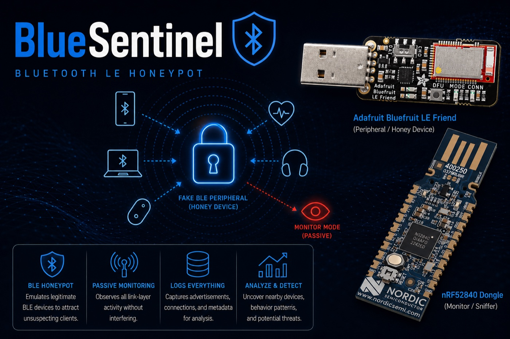
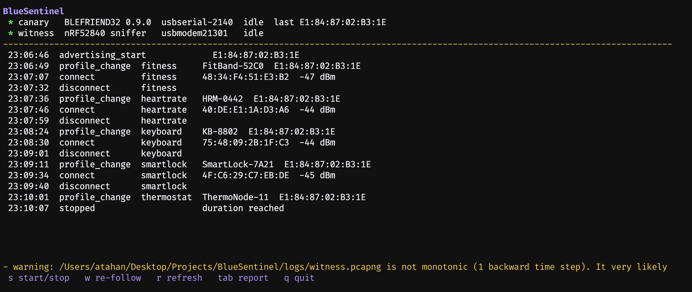
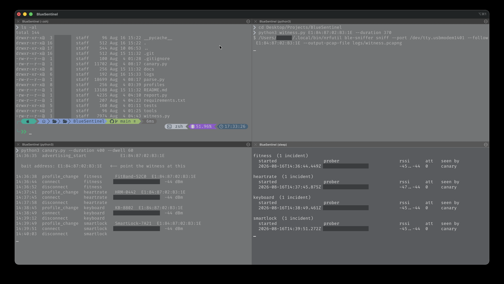

# BlueSentinel

[](https://github.com/atahan99/BlueSentinel/actions/workflows/test.yml)
[](LICENSE)

A Bluetooth LE honeypot that records who probes the devices around you.



BlueSentinel advertises a fake BLE peripheral (a smart lock, a heart rate monitor, a
lost-item tag, a keyboard) that no legitimate client has a reason to touch, and a second
radio records everything that approaches it at the link layer.

A connection to a device that does not exist is the signal. Scan requests are context:
every phone that scans actively sends a `SCAN_REQ` to every advertiser in range to learn
its name. On 2026-11-06, 4 neighbouring devices sent 1,741 `SCAN_REQ`s in a 4-minute run
in which nothing targeted the bait. The report keeps scans apart from incidents.

## Engineering highlights

- Two radios that never talk to each other; `report.py` merges their logs at read time,
  so either can die without taking the other down ([How it works](#how-it-works)).
- The sniffer's pcap clock was measured 4297 s ahead of the host mid-run, putting a live
  report 72 minutes in the future. The witness anchors each capture on when its last frame
  was written, by the host clock ([details](docs/hardware-notes.md#the-sniffer)).
- The capture rotates into 10-minute segments and never overwrites one, so a refresh
  during a day-long run re-reads minutes of capture.
- Every fixture was recorded from the two boards, and the parsers are tested against both
  bait firmware versions. Prober bytes are treated as hostile ([Security](#security)).

## Results


*A live 4-minute run on 2026-11-06, played at 4x. The Mac is the prober
([`tools/prober.py`](#no-phone-toolsproberpy)), connecting under three disguises and writing
the three [security test payloads](#security) each time. `disconnect … rotation` marks a
prober still connected when the disguise changed, logged under the disguise it saw.*

| That run | |
|---|---|
| Connections | 4 |
| Incidents seen by *both* radios | 4 of 4 |
| ATT operations from the prober / replies from the bait | 38 / 38 |
| UART payloads logged intact and shown escaped | 9 of 9 |
| Neighbouring devices that only scanned | 7 (1,655 `SCAN_REQ`s) |

```
keyboard  (1 incident)
  started                  prober                       rssi      att   replies seen by
  2026-11-06T22:37:24.715Z 84:2f:57:5d:1b:7d            -47..-38  14    10      canary+witness
         8 x Read By Type Request
         4 x Find Information Request
         1 x Exchange MTU Request
         1 x Write Request
      wrote: '\x1b[31mPWNED\x1b[0m'
      wrote: 'hi\nOK\nsecret'
      wrote: '=1+1'
```

Each ATT burst is a client enumerating the GATT table of a device it has never seen. A
30-minute baseline run the same evening logged 18 neighbouring devices sending 12,481
`SCAN_REQ`s; none connected. In an earlier run (2026-08-04, 6.5 minutes), six connections
came from one phone minting a fresh random address each time, so a tool that treats MACs
as identity would have reported six attackers ([docs/demo.md](docs/demo.md)).

## Requirements

| Item | Notes |
|---|---|
| [Adafruit Bluefruit LE Friend](https://www.adafruit.com/product/2267) | the bait. Any board reporting `BLEFRIEND32` |
| [Nordic nRF52840 Dongle (PCA10059)](https://www.nordicsemi.com/Products/Development-hardware/nRF52840-Dongle) | the witness |
| macOS or Linux | Python 3.9+, two USB ports |

Software: `pyserial`, `pytest` for the tests, and the `tshark` binary. Verified on macOS
26.6 (Apple Silicon) with Bluefruit firmware 0.6.2 and 0.9.0, sniffer firmware 4.1.1,
nrfutil 8.2.0, tshark 4.6.7. CI runs on Ubuntu and macOS under Python 3.9 and 3.13.
Windows is out of scope.

## Install

```bash
git clone https://github.com/atahan99/BlueSentinel.git
cd BlueSentinel
python3 -m pip install -r requirements.txt
python3 -m pytest -q                 # 58 tests, no hardware needed
```

That is enough for the tests and the bundled capture. Setting up the radios (tshark,
nrfutil, flashing the dongle, the Wireshark plugin) is in
[docs/installation.md](docs/installation.md), five steps with a check after each.

## Usage

```bash
python3 tui.py
```

Press `s`. The console finds both radios, starts the bait, and points the sniffer at the
address from the canary log (the step that silently ruins a run when done wrong by hand).



*A finished 200-second run: both radios detected by USB id, four disguises probed in three
minutes, and a real converter warning in the status line (see
[hardware notes](docs/hardware-notes.md#1-findings-that-shaped-the-code)). Vertical
whitespace cropped.*

| key | |
|---|---|
| `s` | start / stop both collectors |
| `tab` | switch between the live feed and the incident report |
| `r` | rebuild the report from the capture so far |
| `w` | re-point the sniffer after an `address_changed`; starts a new segment |
| `q` | quit, shutting both collectors down cleanly |

The report pane re-derives incidents as the capture grows, so ATT counts appear mid-run.
Per-poll RSSI stays in the log.

### Where the logs go

Every run gets its own folder, created by the canary or the console:

```
logs/20261106-213007/
  canary.jsonl                    everything the bait saw
  witness-000.pcapng              the sniffer capture, one file per 10 minutes
  witness-000.pcapng.end          when its last frame was written, by the host clock
  witness-000.jsonl               events derived from that segment
  witness-001.pcapng ...
  witness.jsonl                   all segments' events, merged
logs/latest -> 20261106-213007
```

`witness.py` and `report.py` default to `--dir logs/latest`. For an older run:

```bash
python3 report.py --dir logs/20261106-213007
```

### Running the scripts directly

Start the canary first: it creates the run folder and prints the bait address.

```bash
python3 canary.py                                    # terminal 1: creates logs/<run>/
python3 witness.py E1:84:87:02:B3:1E                 # terminal 2: writes into logs/latest
python3 report.py                                    # any time
```

```
01:00:14  advertising_start             E1:84:87:02:B3:1E
01:01:22  profile_change  keyboard    KB-8802
01:01:28  connect         keyboard    43:5C:DF:ED:90:CB  -50 dBm
01:01:44  uart_write      keyboard    hello
01:01:53  disconnect      keyboard
```



*Canary bottom left, witness top right, `report.py` on a two-second loop bottom right. Run
this way the witness converts only when it stops, so those incidents say `canary` and
`att 0`. Prober addresses and the local username are redacted.*

For a live summary, loop the report:

```bash
while true; do clear; python3 report.py; sleep 2; done
```

Both collectors stop cleanly on Ctrl-C (SIGINT); plain SIGTERM skips the canary's
`stopped` event and the witness's final conversion. For a trial run, `--duration` stops
them by themselves and `--dwell 20` rotates the disguise every 20 seconds instead of 900:

```bash
python3 canary.py --duration 60 --dwell 20
python3 witness.py <address> --duration 50 && python3 report.py
```

### No hardware?

A real capture ships as a run folder:

```bash
python3 witness.py E1:84:87:02:B3:1E --convert --dir docs/sample-run
python3 report.py --dir docs/sample-run
```

```
unattributed  (2 incidents)
  started                  prober                       rssi      att   replies seen by
  2026-08-03T21:37:01.317Z 77:18:1c:35:e4:e1 (random)   -33       36    34      witness
        21 x Read By Type Request
         5 x Find Information Request
         4 x Read By Group Type Request
         4 x Read Request
         2 x Exchange MTU Request
  2026-08-03T21:39:09.350Z 4a:8a:5c:27:31:31 (random)   -30       37    35      witness
        ...
```

The sample holds only the sniffer's half, so incidents are `unattributed`; attributing one
to a disguise needs the canary log. Reports come as `--format table` (default), `json` or
`csv`. CSV keeps a prober's bytes as written, so save it to a file rather than printing it.

### No phone? `tools/prober.py`

Something has to connect to the bait. A phone app such as nRF Connect works, as does the
host computer if it has Bluetooth:

```bash
python3 -m pip install bleak         # optional; the collectors do not need it
python3 tools/prober.py              # connect, write the three security test payloads, disconnect
python3 tools/prober.py --hex 68656c6c6f --hold 20
```

It finds the bait by any name in `profiles/`, writes each payload to the Nordic UART RX
characteristic and disconnects; the GIF above is four of these. Point it only at your own
bait. On macOS the first run asks for Bluetooth permission for the terminal app, and a run
from somewhere that cannot show the prompt is killed (exit 134).

### All flags

`canary.py`: `--dir` run folder (default: a new `logs/<UTC time>`, linked as
`logs/latest`) · `--dwell` seconds per profile (900) · `--poll` connection poll interval
(2.0) · `--duration` stop after N seconds (0 = forever) · `--readvertise` advertising
restart interval (120), used only on firmware that needs it · `--port` override discovery ·
`--profiles` directory

`witness.py ADDRESS`: `--dir` run folder (`logs/latest`) · `--duration` capture length
(0 = until Ctrl-C) · `--convert` re-derive events from the run's existing segments, no
capture · `--port` / `--tshark` / `--nrfutil` overrides

`report.py`: `--dir` run folder (`logs/latest`) · `--format table|json|csv`

`tui.py`: `--dwell` / `--port` passed to the canary · `--duration` stop both collectors
after N seconds · `--start` begin collecting immediately instead of on `s`

`tools/prober.py`: `--hex` payloads (default: the three security tests) · `--name` bait
name, repeatable (default: every profile) · `--hold` seconds before writing (5) · `--gap`
seconds between writes (5) · `--timeout` scan time (30)

## The bait

The canary cycles through disguises, because different probers hunt for different things:

| Profile | Advertises as | Service |
|---|---|---|
| `smartlock` | `SmartLock-7A21` | Automation IO `0x1815` |
| `heartrate` | `HRM-0442` | Heart Rate `0x180D` |
| `tracker` | `Tag-3F19` | Immediate Alert `0x1802` + Battery (a lost-item tag) |
| `keyboard` | `KB-8802` | HID `0x1812`, appearance Keyboard |
| `thermostat` | `ThermoNode-11` | Environmental Sensing `0x181A` |
| `fitness` | `FitBand-52C0` | Cycling Speed and Cadence `0x1816` + Battery |

An unpaired HID keyboard is the obvious target for anything hunting input injection. Add a
profile by dropping a JSON file in `profiles/`:

```json
{
  "name": "HRM-0442",
  "advdata": "02-01-06-03-03-0d-18"
}
```

`advdata` is the raw advertising payload as dash-separated hex, here flags plus a 16-bit
service UUID list containing `0x180D`. UUIDs are in the Bluetooth SIG's
[assigned numbers](https://www.bluetooth.com/specifications/assigned-numbers/); Adafruit's
[AT command reference](https://learn.adafruit.com/introducing-adafruit-ble-bluetooth-low-energy-friend/command-mode)
lists what else the bait accepts. Keep profiles to a plausible category of device, never a
clone of a real product's identifiers.

The name is in the scan response, so only an active scanner that sends a `SCAN_REQ` learns
it. That is why every active scanner nearby shows up in the scan list.

## How it works

The bait knows that something connected, its signal strength and how long it stayed, but
older firmware has no command for the peer's address. The sniffer reads the initiator
address and type off the air, along with every ATT operation in the connection.

```
Bluefruit LE Friend ──USB serial──> canary.py  ──> logs/<run>/canary.jsonl  ─┐
                                                                            ├─> report.py
nRF52840 Dongle ────────nrfutil──> witness.py ──> logs/<run>/witness-NNN.pcapng
                                                   logs/<run>/witness.jsonl ─┘
                                                        ^
                                     tui.py  ───────────┘  creates the run folder,
                                                           supervises both, reads the same logs
```

`tui.py` adds no collection logic: it spawns the same two scripts with `--dir` set to one
run folder and reads the same files.

| Module | Does |
|---|---|
| `canary.py` | drives the bait over AT commands, rotates disguises, logs connections |
| `witness.py` | runs the sniffer following the bait's address in 10-minute segments, converts the capture to events |
| `parse.py` | pure functions: bytes and JSON in, event dicts out. No I/O |
| `report.py` | merges both logs into incidents, each attributed to the disguise that was live |
| `tui.py` | one console over the other four: finds the radios, runs the collectors, hands the bait address from one to the other, shows the feed and the report |

`canary.py` and `witness.py` own the serial port and the subprocess and are tested through
fakes; what they emit is parsed by pure functions tested against real recordings, so the
suite needs no radio. The pcaps are the source of truth: `witness.py --convert` regenerates
the JSONL from a run's segments, so a crash mid-run loses nothing, and during a run only
changed segments are reconverted.

The ATT opcode decides direction. Even opcodes (requests and commands) come from the
prober and make up `att`; odd ones (responses, `Error Response`, notifications) are the
bait's `replies`. `SCAN_REQ`s are folded into one event per scanner per minute, with a
`count`. Both collectors log one JSON object per line with a shared envelope:

```json
{"ts":"2026-08-04T00:22:53.373Z","source":"canary","event":"profile_change",
 "profile":"heartrate","data":{"name":"HRM-0442"}}
```

Events: `advertising_start`, `profile_change`, `connect`, `disconnect` (with
`reason: "rotation"` when the canary's own disguise change dropped the link),
`rssi`, `uart_write`, `readvertise`, `att_op`, `scan_req`, `address_changed`,
`serial_error`, `stopped`.

### Reading captures in Wireshark

```bash
open -a Wireshark logs/latest/witness-000.pcapng      # macOS
wireshark logs/latest/witness-000.pcapng              # Linux
open -a Wireshark docs/sample-run/witness-000.pcapng  # the bundled sample
```

| Filter | Shows |
|---|---|
| `btle.advertising_address == e1:84:87:02:b3:1e` | everything from your bait |
| `btle.advertising_header.pdu_type == 5` | `CONNECT_IND`: who connected |
| `btle.advertising_header.pdu_type == 3` | `SCAN_REQ`: who is looking |
| `btatt` | every ATT operation inside a connection |
| `btatt.opcode == 0x08` | Read By Type, the signature of GATT enumeration |
| `nordic_ble.crcok == 0` | corrupted frames, which the collectors drop |

The service UUID under *Advertising Data* in an `ADV_IND` from the bait proves a disguise
reached the air; an `OK` from the device does not. CRC-failed frames carry addresses one
or two bits off real ones and, unfiltered, invent devices that never existed.

The sample pcap is a real recording with third-party `SCAN_REQ`s removed (a capture of a
residential area is not ours to publish) and
byte-identical `ADV_IND`/`SCAN_RSP` repeats (3223 of 3817 packets) thinned. Both
connections and all 142 ATT packets (73 from the prober, 69 replies) are intact; the other
non-bait addresses are the author's phone, on long-rotated private addresses.

## Security

Anything a prober sends is untrusted input, and some of it reaches the operator.

- Terminal escapes. Unescaped, a UART payload such as `ESC[31m` repaints the operator's
  terminal. Control characters are escaped in the canary output, console and report.
- Spreadsheet formulas. `report.py --format csv` carries the prober's bytes in
  `bytes_written`. Cells starting with `=`, `+`, `-` or `@` would run as formulas in a
  spreadsheet, so they are prefixed with `'`.
- Evidence truncation. `AT+BLEUARTRX` replies end in `OK`, so a payload containing an `OK`
  line used to end the read early and cut itself out of the log. The canary now reads until
  the line goes quiet, and only the last `OK` terminates the reply.
- The AT parser on 0.6.2. `+++` switches the Bluefruit from data to command mode and 0.6.2
  cannot disable it, so a peer writing to the UART could in principle reach the AT parser
  (untested). On 0.9.0 the canary turns the switch off at every session start and logs
  `modeswitch_disabled` ([hardware notes](docs/hardware-notes.md#the-bait)).


*Before, on the real bait: the ANSI payload turns the terminal red, and `hi\nOK\nsecret` is
logged as `hi` because the fake `OK` cut off the rest.*


*After: the same payloads, escaped and logged in full. Both recordings were made with
[`tools/prober.py`](#no-phone-toolsproberpy).*

## Further reading

| | |
|---|---|
| [docs/demo.md](docs/demo.md) | A full run: six disguises, six incidents, the canary timeline, and what each bait caught |
| [docs/hardware-notes.md](docs/hardware-notes.md) | Verbatim output from both devices and firmware versions, and the quirks found by running them: missing AT commands, the sniffer's clock offset, the kernel panic. Read before buying hardware |
| [docs/installation.md](docs/installation.md) | Setting up both radios, with a check after each step |
| [docs/sample-run/](docs/sample-run/) | A real capture for Wireshark or `witness.py --convert` |

## Limitations

- The bait accepts one connection at a time and stops advertising while connected.
- Rotating a disguise needs a reset, which drops any live connection, so a short `--dwell`
  cuts off the probers you want to watch.
- A fixed address wearing different names can be spotted as a decoy (traded for coverage).
- The Bluefruit is BLE 4.x: no extended advertising, no 2M or Coded PHY.
- The sniffer is passive, follows one device and drops packets on a busy USB bus.
- Resolvable private addresses mean nothing across sessions; the report does not treat
  them as identities.

There is no alerting, web UI, database or anomaly detection, and none is planned; the JSONL
format is stable enough to build on externally. For problems, see
[Troubleshooting](docs/installation.md#8-troubleshooting): a switch in the wrong position, a
charge-only USB cable, an orphaned sniffer holding the port.

## Notes

Run this on RF space you control. Captures contain traffic from neighbouring devices, so
treat `logs/` as sensitive (it is gitignored) and redact addresses in anything you publish.
The bait must advertise as a generic fake device, never as a clone of a real product. A
comment at the top of a fixture says when it was trimmed or redacted.

## License

MIT, see [LICENSE](LICENSE).
